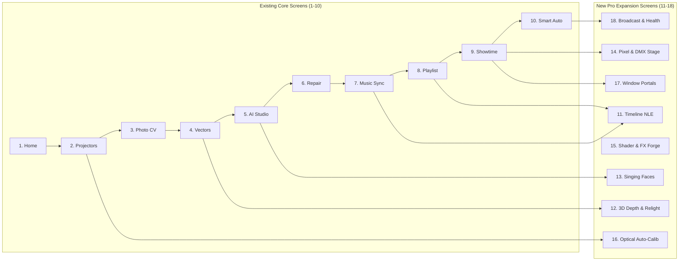

# Lumen-Map AI: Master Expansion Plan (50 New Features, 8 New Screens & 14 Modal Dialogs)

> [!IMPORTANT]
> **Instructions for AI Implementation Agents**: This document is the authoritative architectural specification for expanding **Lumen-Map AI (Marshall Projection Studio)** beyond its current 10-screen baseline. Follow the state schemas, file paths, mathematical models, and UI layout blueprints defined below when implementing any feature, screen, or modal dialog from this plan. **Do not break existing 1–10 screen numbering or store persistence.**

---

## Part 1: Gap Analysis — What Are We Missing & What Have We Not Yet Covered?

After auditing the current 10 screens ([`Screen1Home.tsx`](file:///e:/Documents/AiPrograms/GemniProjection%20Studio/src/screens/Screen1Home.tsx) through [`Screen10MusicSync.tsx`](file:///e:/Documents/AiPrograms/GemniProjection%20Studio/src/screens/Screen10MusicSync.tsx)) and [`useProjectionStore.ts`](file:///e:/Documents/AiPrograms/GemniProjection%20Studio/src/store/useProjectionStore.ts), here are the **8 major functional gaps** that real-world architectural projection mapping creators and holiday light show designers need:

1. **No Multi-Track Non-Linear Timeline (NLE)**:
   - *Current State*: Screen 8 (Playlist) only plays one video clip at a time in a sequential queue (`PlaylistClip[]`).
   - *What's Missing*: Real projection shows layer multiple visual elements simultaneously—e.g., a base brick-wall texture on Track 1, an animated fire shader inside the windows on Track 2, a transparent WebM singing pumpkin on Track 3, and keyframed DMX/opacity envelopes on Track 4.
2. **No 3D Facade Depth / Normal Map Relighting**:
   - *Current State*: The house is treated as flat 2D vector polygons (`VectorLayer[]`).
   - *What's Missing*: AI monocular depth estimation (Depth-Anything / MiDaS style) and surface normal maps so virtual 3D point lights, lightning bolts, and cursor-driven spotlights cast realistic directional shadows across window sills, pillars, and roof gables.
3. **No Singing Faces / Talking Character Lip-Sync Engine**:
   - *Current State*: Singing pumpkins or characters must be pre-baked in external video software.
   - *What's Missing*: An audio-to-phoneme (Preston Blair mouth shapes: `A, E, I, O, U, M/B/P, F/V, L, W/Q, Rest`) lip-sync studio that lets users drop any MP3 song or speak into a live microphone to animate talking pumpkins, ghosts, Santa, or monsters pinned inside specific window or garage masks.
4. **No Wall Color / Brick Pigment Neutralization**:
   - *Current State*: Projecting onto dark red brick, tan stucco, or yellow siding tints the entire projection.
   - *What's Missing*: Surface color radiometric compensation that samples the daytime photo's RGB albedo per mask zone and applies an inverse color-matrix LUT so white light looks truly white on red brick or colored siding.
5. **No Physical Pixel / xLights / WLED / Moving-Head Stage Integration**:
   - *Current State*: Only basic boolean DMX strobe/PIR status indicators exist on Screen 9.
   - *What's Missing*: Many projection mapping houses also run WLED/xLights RGB pixel strips along roof eaves, E1.31/sACN universes, DMX moving-head spots, and fog machines. We need a unified visualiser and bridge so video colors automatically bleed into physical roofline LEDs.
6. **No Camera-Projector Structured-Light Auto-Calibration**:
   - *Current State*: Users manually drag 4 corner pins or vector vertices by eye.
   - *What's Missing*: Automated structured-light calibration (projecting Gray-code stripes or ArUco fiducial markers, capturing via webcam/iPhone, and computing a sub-pixel homography + obstruction mask automatically) plus a physical **Throw Distance & Lens Calculator**.
7. **No Real-Time Procedural Physics & Weather Shaders Mapped to Geometry**:
   - *Current State*: Relies on pre-rendered MP4s or basic SVG overlays.
   - *What's Missing*: Real-time GPU procedural shaders that *know* where the roof eaves and window sills are—e.g., snow that physically piles up on top of window frames and roof ridges, rain that splashes off the garage top, or 3D Voronoi bricks that crumble and fall with gravity.
8. **No Multi-Window Interior Portal & Yard Prop Synchronizer**:
   - *Current State*: Assumes a single exterior projector hitting the front facade.
   - *What's Missing*: Synchronizing interior rear-projection window scrims ("Hollusions") and yard props (arches, tombstones, singing trees) with the main house projection so a character can walk from an upstairs bedroom window down into the living room window seamlessly.

---

## Part 2: 50 Brand-New Useful Tools & Features (Detailed AI Blueprint)

Below are **50 distinct, high-value tools and features** organized into 7 engineering domains. Each entry specifies what it does and how an AI agent should implement it.

### Category A: Optics, Geometry, Warping & Calibration (Features #1 – #8)

#### 1. Sub-Grid Bezier Mesh Warping (NxM Control Lattice)
- **Description**: Upgrades simple 4-corner pin warping into a customizable $3\times3$, $5\times5$, or $9\times9$ bicubic Bezier control lattice for curved surfaces (bay windows, cylindrical pillars, arched porticos, uneven driveways).
- **AI Implementation**: Add `meshGridSize: [number, number]` and `meshControlPoints: VectorVertex[][]` to `VectorLayer` and `ProjectorOutput`. Render interactive bicubic SVG/WebGL subdivision patches in Screen 2 and Screen 4.

#### 2. Radiometric Wall Color & Brick Pigment Neutralizer
- **Description**: Samples the underlying house surface color (e.g., red brick, beige siding) from the daytime reference photo and applies an inverse chromatic adaptation matrix per vector layer so projected colors aren't muddy or tinted.
- **AI Implementation**: Sample average RGB from `customReferencePhotoUrl` inside each `VectorLayer` polygon; compute inverse gain $(1 - k \cdot C_{\text{wall}})$ via `<feColorMatrix>` in SVG/WebGL output.

#### 3. Physical Throw Distance, Lens Shift & Foot-Lambert Calculator
- **Description**: Calculates required projector distance, image width/height, lens throw ratio ($0.5\text{–}2.5$), vertical/horizontal lens shift limits, and surface brightness in Foot-Lamberts ($\text{fL}$) based on projector ANSI lumens and ambient street light.
- **AI Implementation**: Create `src/utils/opticsCalculator.ts` and mount in Screen 2 (Projectors) & a dedicated Calculator Modal. Formula: $W = D / R_{\text{throw}}$, $\text{fL} = \text{Lumens} / (W \times H)_{\text{sq.ft}} \times \text{Gain}$.

#### 4. Structured-Light Gray-Code Camera Auto-Alignment
- **Description**: Flashes horizontal and vertical binary Gray-code stripe sequences onto the house while capturing frames from a connected webcam/smartphone to automatically solve the pixel-to-projector correspondence map.
- **AI Implementation**: Add Gray-code pattern generator to [`ProjectorTestPatternRenderer.tsx`](file:///e:/Documents/AiPrograms/GemniProjection%20Studio/src/components/ProjectorTestPatternRenderer.tsx) and decode captured `MediaStream` frames in `src/utils/structuredLightSolver.ts`.

#### 5. Auto Obstruction & Tree Branch Shadow Cutter
- **Description**: Compares the camera feed of an all-white projector flash against the daytime photo to automatically detect foreground obstructions (tree branches, bushes, parked cars, power lines) and convert them into feathered `Hard Blackout Cutout` masks.
- **AI Implementation**: Compute luminance difference threshold $|I_{\text{white\_flash}} - I_{\text{ambient}}| < \tau$, run marching-squares contour extraction, and append to `layers` as `Hard Blackout Cutout`.

#### 6. Perspective Sweet-Spot (Anamorphic) Viewer Point Simulator
- **Description**: Lets the user set the exact street/sidewalk coordinate where spectators stand (e.g., 35 ft back, 10 ft left of center) and pre-distorts forced-perspective 3D illusions so they look geometrically perfect from that exact viewing angle.
- **AI Implementation**: Store `spectatorSweetSpot: { x: number, y: number, z: number }` in store; compute off-axis frustum homography matrix $H_{\text{anamorphic}}$ in [`src/utils/projectionMath.ts`](file:///e:/Documents/AiPrograms/GemniProjection%20Studio/src/utils/projectionMath.ts).

#### 7. Sub-Pixel Chromatic Aberration (RGB Panel Convergence) Corrector
- **Description**: Compensates for cheap projector lenses where Red, Green, and Blue channels fringing separates at the extreme corners of the house by allowing $\pm 3.0\text{px}$ independent R/G/B channel X/Y shift.
- **AI Implementation**: Add `rgbConvergence: { rX: number; rY: number; bX: number; bY: number }` to `ProjectorOutput` and apply via SVG `<feOffset>` + `<feBlend mode="screen">` in [`ProjectorOutputView.tsx`](file:///e:/Documents/AiPrograms/GemniProjection%20Studio/src/components/ProjectorOutputView.tsx).

#### 8. Multi-Angle Smartphone AR Alignment Overlay (WebRTC Companion)
- **Description**: Generates a local QR code that opens the user's phone camera with a translucent wireframe overlay of the house masks, allowing the user to stand in the front yard and nudge vertices on their phone screen with zero walk-back.
- **AI Implementation**: Create a mobile-optimized touch pad view (`?companion=true`) synced via `BroadcastChannel` / WebSocket to `useProjectionStore`.

---

### Category B: Vector CAD, Smart Masking & Architectural Tools (Features #9 – #16)

#### 9. Boolean Polygon Operations (Union, Subtract, Intersect, XOR)
- **Description**: Allows combining two overlapping layers (e.g., subtracting all 4 `Windows` polygons from the `Main Walls` polygon with one click so wall textures never project over window glass).
- **AI Implementation**: Add Sutherland-Hodgman / Martinez-Rueda polygon clipping in `src/utils/polygonBoolean.ts` and add 4 Boolean action buttons to the Screen 4 (Vectors) toolbar.

#### 10. Parametric Architectural Shingle, Brick & Siding Grid Generator
- **Description**: Automatically subdivides any wall or roof polygon into individual procedural bricks, roof shingles, or horizontal siding planks so each brick can explode, light up, or fall independently.
- **AI Implementation**: Add `subdividePolygonToBricks(vertices, rows, cols, stagger)` in `src/utils/architecturalSubdivider.ts`, generating child sub-polygons inside the selected `VectorLayer`.

#### 11. Symmetry & Architectural Clone Array Tool (Linear & Radial)
- **Description**: Duplicates a drawn window pane, pillar, or baluster across a horizontal/vertical axis or into an $N\times M$ French-window grid with automatic spacing and perspective foreshortening.
- **AI Implementation**: Add an "Array / Clone" popover in Screen 4 (Vectors) with `rows`, `cols`, `gapX`, `gapY`, and `perspectiveTaper` parameters.

#### 12. Magnetic Canny-Edge Live Lasso (Intelligent Scissors)
- **Description**: While drawing with the Pen tool on Screen 4, the cursor magnetically snaps to high-contrast roofline and window edges detected in the underlying reference photo.
- **AI Implementation**: Precompute a Sobel/Canny gradient magnitude map on an offscreen `<canvas>` from `customReferencePhotoUrl` and snap cursor within `snapMagnetism` radius to local gradient maxima.

#### 13. Variable-Width Per-Vertex Edge Feathering
- **Description**: Instead of one uniform feather radius for an entire polygon, allows each vertex or edge segment to have its own feather width (e.g., sharp $0\text{px}$ edge against a window frame, soft $25\text{px}$ fade into the lawn at the bottom).
- **AI Implementation**: Extend `VectorVertex` with `featherRadius?: number` (`src/store/useProjectionStore.ts`) and render edge-specific gradient strokes along polygon segments.

#### 14. Auto-Perspective Extrusion (2D Polygon to 3D Box/Recess)
- **Description**: Takes any 2D window or door rectangle and extrudes inward/outward 3D depth walls (top soffit, left/right jambs, bottom sill) toward a configurable vanishing point to create deep recessed "alcove" illusions.
- **AI Implementation**: Add `extrudeDepth: number` and `vanishingPoint: { x: number; y: number }` to `VectorLayer`, automatically computing the 4 inner/outer trapezoid side faces.

#### 15. Dynamic Moving-Object Mask Tracker (Swaying Trees / Inflatable Props)
- **Description**: Uses optical flow on the live security camera feed to slightly shift blackout or projection masks in real time when wind causes yard inflatables or tree branches to sway.
- **AI Implementation**: Track centroid displacement inside a bounding box via frame-differencing on the camera feed and apply a smoothed delta offset $(\Delta x, \Delta y)$ to linked `VectorLayer` vertices.

#### 16. CAD Dimensioning, Tape Measure & Real-World Scale Calibration
- **Description**: Lets the user measure any known real-world length on the house (e.g., "Standard 80-inch tall front door = 142 pixels") so all tools display measurements in real feet/inches and meters.
- **AI Implementation**: Add `pixelsPerFoot: number` to store and a "Tape Measure" tool in Screen 4 (Vectors) that renders architectural dimension lines with feet/inches labels.

---

### Category C: 3D Depth, Procedural Shaders & Particle Physics (Features #17 – #24)

#### 17. Monocular AI Depth & Surface Normal Map Generator
- **Description**: Synthesizes a 16-bit grayscale Depth Map ($Z$-buffer) and RGB Surface Normal Map ($\vec{N}_x, \vec{N}_y, \vec{N}_z$) from the house photo so 2D facades react like 3D geometry.
- **AI Implementation**: Create `src/utils/depthNormalSynthesizer.ts` that combines architectural zone depths (sky = far, roof = sloped, walls = mid, pillars/garage = near) with emboss gradients to output normal & depth data URLs.

#### 18. Interactive Virtual 3D Sun, Moon & Moving Spotlight Relighting
- **Description**: Places virtual 3D point lights, sweeping helicopter searchlights, or eerie Halloween under-lighting in 3D space that cast real-time Lambertian/Phong highlights and long shadows across the house normal map.
- **AI Implementation**: Use SVG `<feSpecularLighting>` / `<feDiffuseLighting>` with `<fePointLight>` / `<feSpotLight>` driven by keyframed or audio-reactive $(X, Y, Z)$ coordinates.

#### 19. Geometry-Aware Snow & Icicle Accumulation Physics
- **Description**: Falling snow particles collide with the top edges of `Roofline` and `Windows` vector layers, gradually piling up into thick white snowbanks and growing procedural icicles that hang down from roof eaves.
- **AI Implementation**: Build a 2D heightfield array `snowHeight[x]` pinned to upper horizontal segments of `Roofline`/`Windows` layers on an HTML5 `<canvas>` overlay.

#### 20. 3D Rigid-Body Brick Crumble & Wall Shatter Simulator
- **Description**: Shatters any selected wall or garage mask into Voronoi fragments or brick tiles that crack, tip forward, and tumble down the facade with gravity, revealing a hidden cavern, monster, or Santa's workshop behind the wall.
- **AI Implementation**: Create `src/components/BrickShatterCanvas.tsx` with Verlet physics integration, rotational torque, and background reveal layer compositing.

#### 21. Window-Aware Fire, Smoke & Dripping Ectoplasm Fluid Sim
- **Description**: Generates procedural flames and smoke that rise from the bottom sill of window masks and curl around the top arch, or viscous green ectoplasm/icicles that drip down from roof gutters.
- **AI Implementation**: Implement a cellular / Perlin-noise advection shader masked to `Windows` and `Roofline` polygons with configurable buoyancy and viscosity.

#### 22. Interactive Lightning Bolt & Tesla Arc Generator (Vertex-to-Vertex)
- **Description**: Fires procedural branching electrical arcs that jump specifically between house architectural vertices (e.g., from the garage Ecto-1 to the roof peak, or between window corners) synced to thunder audio peaks.
- **AI Implementation**: Midpoint-displacement fractal lightning algorithm connecting sampled vertices from `layers`, triggered by `audioLevels.bass` or manual cues.

#### 23. Procedural Stained-Glass, Frost & Haunted CobwebGenerator
- **Description**: Transforms any window mask into a glowing gothic stained-glass mosaic, creeping ice-crystal frost that freezes inward from the window corners, or dusty cobwebs that tear open.
- **AI Implementation**: Add Voronoi/Delaunay procedural pattern generator scoped to `Windows` category layers with animated radial reveal masks.

#### 24. Real-Time Liquid Ripple, Portal Vortex & Black-Hole Distortion
- **Description**: Warps the house facade as if the brick wall is made of rippling water, or sucks the center of the house into a swirling gravitational vortex.
- **AI Implementation**: Apply `<feDisplacementMap>` with animated radial/turbulence displacement textures centered on user-definable anchor coordinates.

---

### Category D: AI Video, Singing Characters & Content Studio (Features #25 – #32)

#### 25. AI Singing Faces & Phoneme Lip-Sync Puppet Studio
- **Description**: Automatically analyzes vocal audio tracks (or live microphone input) and animates 10 mouth shapes (Preston Blair visemes) for singing pumpkins, talking ghosts, magic mirrors, or Santa Claus mapped inside any window or wall zone.
- **AI Implementation**: Extract formant frequency bands ($300\text{–}3000\text{Hz}$) in WebAudio to classify visemes (`Rest, A/I, E, O, U, M/B/P, F/V, L, W`) and render SVG/sprite character rigs in real time.

#### 26. Multi-Zone Regional Prompt Compositor (Per-Mask AI Prompts)
- **Description**: Lets the user assign *different* AI video prompts to individual house zones in a single generation pass (e.g., `Garage`: *"Cyberpunk mech bay"*, `Left Window`: *" silhouette of dancing witch"*, `Roofline`: *"Glowing neon circuit tiles"*).
- **AI Implementation**: Extend `VectorLayer` with `regionalPrompt?: string` and `regionalNegativePrompt?: string`, and composite regional conditioning masks before calling [`apiClient.ts`](file:///e:/Documents/AiPrograms/GemniProjection%20Studio/src/utils/apiClient.ts).

#### 27. Seamless Loop Cross-Synthesizer & Optical Flow Morph
- **Description**: Eliminates hard jump cuts when a 10s or 30s AI video loops by blending the last 45 frames into the first 45 frames using bidirectional optical-flow motion interpolation.
- **AI Implementation**: Add a dual-video buffer cross-morph controller in `Screen4AiVideoStudio.tsx` and exportable loop baker.

#### 28. Chroma-Key (Green/Blue Screen) & Luma-Key Prop Extractor
- **Description**: Allows importing standard stock videos (ghosts on green screen, fireworks on black background, snow overlays) and keying out the background with spill suppression and edge choke directly inside the app.
- **AI Implementation**: Create a real-time WebGL/SVG `<feColorMatrix>` chroma/luma key filter per clip with `keyColor`, `similarity`, `smoothness`, and `spillSuppression` sliders.

#### 29. AI Style-Transfer & Seasonal Re-Skinner (Day-to-Night / Summer-to-Winter)
- **Description**: Converts a sunny daytime smartphone photo of the user's house into a photorealistic midnight reference photo (turning off sky light, adding moonlight, or converting summer grass/roofs into winter snow).
- **AI Implementation**: Add a "Day-to-Night Reference Converter" in Screen 3 (`Screen3PhotoToLayout.tsx`) with relighting curves, sky replacement mask, and AI img2img conditioning.

#### 30. Sprite-Sheet & Transparent WebM Decal Sticker Placer
- **Description**: Provides a drag-and-drop library of animated decals (crawling spiders, boarding planks, bullet holes, Christmas wreaths, twinkling fairy lights, eyes in the dark) that can be pinned, scaled, and rotated anywhere on the facade.
- **AI Implementation**: Add `SceneDecal[]` array to `useProjectionStore.ts` with `{ id, assetType, x, y, scale, rotation, opacity, layerBindId, animationSpeed }`.

#### 31. Dynamic Text, Countdown Clock & Scrolling Marquee Ticker
- **Description**: Projects 3D perspective-warped text banners onto the roof or garage (e.g., *"HAPPY NEW YEAR 2027 — 00:04:12"*, *"TUNE RADIO TO 89.7 FM"*, or *"HAPPY BIRTHDAY AUSTIN"* with gold firework particles).
- **AI Implementation**: Add a `TextOverlayLayer` engine supporting custom fonts, neon glow, typewriter/scroll animations, live countdown timers, and homography warp binding.

#### 32. AI Foley & Spatial Sound Effect Auto-Generator
- **Description**: Automatically synthesizes or layers synchronized sound effects (rumbling bricks, shattering glass, thunderclaps, eerie wind, sleigh bells) matched to visual events and beat flags on the timeline.
- **AI Implementation**: Expand [`src/utils/soundEffects.ts`](file:///e:/Documents/AiPrograms/GemniProjection%20Studio/src/utils/soundEffects.ts) into a multi-voice procedural WebAudio synthesizer + sample trigger bank tied to timeline cues.

---

### Category E: Audio, Music Sync & Multi-Track Timeline (Features #33 – #38)

#### 33. Multi-Track Non-Linear Timeline Editor (Video + Shaders + DMX + Audio)
- **Description**: Full horizontal scrubbable NLE timeline with multiple stacked tracks (Background Video, Window Portals, Decal Sprites, Procedural Shaders, Audio Waveform, DMX/WLED Automation Envelopes) and bezier keyframe curves.
- **AI Implementation**: Build Screen 11 (`Screen11TimelineSequencer.tsx`) with zoomable time-ruler, draggable clip blocks, keyframe diamonds, and real-time playhead evaluation.

#### 34. AI 4-Stem Audio Splitter (Vocals, Drums, Bass, Melody Isolation)
- **Description**: Splits any imported MP3 song into 4 isolated stems (`Vocals`, `Drums`, `Bass`, `Other/Melody`) so the user can bind `Vocals` to the Singing Pumpkin lip-sync, `Drums` to the roofline strobe, and `Bass` to the garage sub-pulse.
- **AI Implementation**: Implement multi-band zero-phase Butterworth/Biquad filter banks + mid/side vocal center-channel extraction in `src/utils/stemSplitter.ts` with 4 independent VU meters and solo/mute buttons.

#### 35. MIDI Controller, OSC & Elgato StreamDeck Hardware Mapper
- **Description**: Uses the browser's native **WebMIDI API** (`navigator.requestMIDIAccess()`) and WebSocket OSC so users can plug in any physical MIDI launchpad, DJ fader board, or StreamDeck to trigger live cues, scrub brightness, or tap beats tactilely.
- **AI Implementation**: Create `src/utils/midiOscController.ts` with a "MIDI Learn" mode that binds any physical CC fader or Note pad to store actions.

#### 36. Live Microphone / Line-In Actor Voice Changer & Puppet Trigger
- **Description**: Lets the homeowner speak into a headset microphone on Halloween night with real-time pitch-shifting/reverb (Demon, Ghost, Robot, Santa) while their live voice drives the projected character's mouth on the house!
- **AI Implementation**: Connect `navigator.mediaDevices.getUserMedia({ audio: true })` to a WebAudio delay-line pitch shifter + convolver reverb and feed real-time RMS/formants to the Singing Face rig.

#### 37. SMPTE LTC Timecode & Multi-PC Network Genlock Sync
- **Description**: Generates and reads SMPTE Linear Timecode (LTC) audio signals and NTP/WebSocket frame sync so multiple computers or Raspberry Pi Falcon Players stay locked within $<5\text{ms}$ across a large property.
- **AI Implementation**: Add LTC frame clock generator (`HH:MM:SS:FF` at 24/29.97/30/60 fps) and `BroadcastChannel` / WebSocket frame-lock heartbeat.

#### 38. Per-Layer Frequency Band Equalizer & ADSR Envelope Follower
- **Description**: Gives every vector layer its own 16-band parametric EQ filter and Attack-Decay-Sustain-Release (ADSR) envelope shaper so audio-reactive visuals move smoothly without jittery flickering.
- **AI Implementation**: Extend `LayerColorModifier` in [`useProjectionStore.ts`](file:///e:/Documents/AiPrograms/GemniProjection%20Studio/src/store/useProjectionStore.ts) with `{ minFreqHz, maxFreqHz, attackMs, releaseMs, threshold, curve }` and process in [`audioBeatAnalyzer.ts`](file:///e:/Documents/AiPrograms/GemniProjection%20Studio/src/utils/audioBeatAnalyzer.ts).

---

### Category F: Smart Yard Hardware, xLights, WLED & IoT (Features #39 – #44)

#### 39. xLights (`.fseq` / `.xsq`) & Falcon Player (FPP) Importer/Exporter
- **Description**: Imports existing xLights sequences and exports synchronized `.fseq` channel data and media packages so holiday light enthusiasts can run Lumen-Map AI alongside their Falcon Player (FPP) controller.
- **AI Implementation**: Create binary `.fseq` v2 header/frame parser & writer in `src/utils/xlightsFppBridge.ts`.

#### 40. WLED / E1.31 (sACN) / Art-Net Pixel Strip Roofline Bridge
- **Description**: Samples the RGB pixel colors along the edges of the projected video in real time and streams them via UDP/WebSocket (E1.31 / WLED JSON API) to physical addressable LED strips mounted on the house eaves and yard arches.
- **AI Implementation**: Sample `<canvas>` pixels along user-drawn LED strip paths at 40 FPS and format into Art-Net / E1.31 / WLED DDP packets.

#### 41. DMX Moving-Head Spotlight & ILDA Laser Path Tracker
- **Description**: Converts 2D/3D target paths drawn on the house canvas into Pan/Tilt DMX-512 16-bit channel values (channels 1–4) so physical moving-head stage lights in the front yard trace the roofline or follow characters across the facade.
- **AI Implementation**: Inverse kinematics Pan/Tilt angle solver $\theta_{\text{pan}} = \arctan2(x - x_0, z)$, $\theta_{\text{tilt}} = \arctan2(y - y_0, \sqrt{(x-x_0)^2 + z^2})$ outputting 16-bit coarse/fine DMX values.

#### 42. FM Radio Transmitter & Dynamic RDS "Now Playing" Text Broadcaster
- **Description**: Manages the homeowner's Whole-House FM Transmitter (e.g., Si4713 / EDM-LCD / FPP FM plugin), automatically broadcasting dynamic RDS radio text (`"LUMEN-MAP SHOW - TUNE 89.7 FM - SONG: GHOSTBUSTERS"`) to car stereos parked outside.
- **AI Implementation**: Add RDS PS (8-char) and RT (64-char) formatter and API/Serial webhook dispatcher in Screen 18 and Live Showtime.

#### 43. Weather Station, Wind-Speed & Projector Thermal/Dew-Point Guard
- **Description**: Polls local weather API + enclosure DHT22/DS18B20 telemetry (wind MPH, rain probability, projector exhaust temp, internal humidity vs. dew point) to automatically trigger projector cool-down, close motorized enclosure shutters, or pause high-wind inflatable masks.
- **AI Implementation**: Add `weatherTelemetry` state and automated safety rules engine in Screen 10 / Screen 18.

#### 44. Driveway Vehicle / Headlight Glare Blocker & Welcome Trigger
- **Description**: Detects when a car pulls into the driveway or shines headlights across the projection zone—automatically dimming or masking the lower garage area to prevent blinding drivers while triggering a custom "Welcome Home" or "Spectator Arrived" cue.
- **AI Implementation**: Add zone-based high-luminance glare detector on the security camera feed + webhook trigger.

---

### Category G: Audience Experience, Operations & Production Workflow (Features #45 – #50)

#### 45. Spectator Smartphone Live Arcade & Interactive Mini-Games
- **Description**: Upgrades the spectator QR portal from simple voting into live interactive projection games—e.g., *"Tap ghosts on your phone to zap them with proton beams on the house"* or *"Throw virtual snowballs at the house windows"*.
- **AI Implementation**: Add interactive hit-target coordinates `(normX, normY)` from spectator events that spawn proton-beam / snowball impact animations on the live projector output.

#### 46. Neighbor Light-Spill, Acoustic Decibel & HOA Compliance Monitor
- **Description**: Calculates stray light lumens spilling past the roofline into the night sky or neighbor windows, monitors live audio dB(A) SPL via microphone, and automatically engages "Late-Night Whisper & Low-Lumen Mode" after curfew.
- **AI Implementation**: Compute percentage of non-black pixels outside house silhouette polygons (`straySpillPercent`) + WebAudio RMS-to-dB SPL meter with automated compressor/limiter.

#### 47. Multi-Window Interior Rear-Projection ("Hollusion") Synchronizer
- **Description**: Coordinates secondary indoor projectors or TVs placed inside bedroom/living-room windows with the main outdoor facade projector so characters appear to walk *inside* the rooms and look out through the glass.
- **AI Implementation**: Extend `ProjectorOutput` with `placementMode: 'exterior-front' | 'interior-window-rear' | 'yard-prop-scrim'`, automatically applying horizontal mirror flip and window-frame cropping.

#### 48. Overnight Batch AI Render Farm & Queue Manager
- **Description**: Instead of waiting for one AI video prompt at a time, lets the user queue up 10–40 prompt variations (with different seeds, themes, or regional masks) to render unattended overnight with automatic retry and disk/IndexedDB caching.
- **AI Implementation**: Create `renderQueue: RenderJob[]` in `useProjectionStore.ts` and a background worker loop with progress bars, ETA, and priority reordering.

#### 49. Project Time-Machine, Visual Diff & Auto-Save Crash Recovery
- **Description**: Automatically snapshots the entire project state to `IndexedDB` every 2 minutes and before destructive edits, allowing the user to scrub through a visual history timeline and compare any two versions side-by-side.
- **AI Implementation**: Create `src/utils/projectTimeMachine.ts` using `IndexedDB` (`lumen_snapshots_db`) with thumbnail previews and JSON state diffing.

#### 50. Standalone Self-Contained Show Player & Raspberry Pi / Mini-PC Kiosk Exporter
- **Description**: Exports the entire calibrated show (warped video loops, SVG blackout masks, beat flags, DMX cues, and schedule) into a zero-dependency standalone HTML5/WebGL kiosk bundle or Falcon Player script that boots straight into fullscreen playback on a mini-PC.
- **AI Implementation**: Bundle all active state, base64 masks, homography matrices, and playlist schedule into a downloadable self-executing offline `.html` / `.zip` show appliance.

---

## Part 3: New Top-Level Screens (Screens 11 – 18) — Complete Architectural Breakdown

To keep the top navigation bar clean and logical, the application can group screens into **Core Workflow (Screens 1–10)** and **Pro Expansion Modules (Screens 11–18)** accessible via a switchable mode pill or scrollable header ribbon. Below is the exact layout and component specification for each of the **8 new screens**.

---

### Screen 11: Multi-Track Non-Linear Timeline & Keyframe Sequencer (`11. Timeline NLE`)
- **File to Create**: `src/screens/Screen11TimelineSequencer.tsx`
- **Purpose**: Replaces single-clip playback with a professional multi-layer compositor where videos, procedural shaders, singing faces, decals, audio stems, and DMX lighting tracks run in parallel with keyframed properties.
- **What Should Be On This Screen**:
  1. **Top Transport & Timecode Bar**:
     - SMPTE Timecode Readout (`00:01:24:18`), BPM Grid Snap toggle (`1/4, 1/8, 1/16, Bar`), Loop In/Out bracket markers, Split Clip (`S`), Razor Tool (`C`), Ripple Delete, and Render Work Area button.
  2. **Upper-Left Panel (Project Media & Asset Bin)**:
     - Tabs for *AI Video Clips*, *Transparent WebM Decals*, *Procedural Shaders*, *Audio Stems*, and *DMX/WLED Patterns*. Drag-and-drop onto any track.
  3. **Upper-Center Panel (Live Multi-Layer Compositor Monitor)**:
     - 16:9 real-time canvas rendering all active tracks at the current playhead time with house masks, blend modes, and middle-click pan/zoom.
  4. **Upper-Right Panel (Selected Clip & Keyframe Curve Inspector)**:
     - Transform (`X, Y, Scale, Rotation`), Target Mask Binding (`All Surfaces` vs. specific `VectorLayer`), Opacity, Chroma-Key settings, and a **Bezier Speed/Value Graph Editor** (`Ease-In`, `Ease-Out`, `Bounce`, `Hold`).
  5. **Bottom Half (Multi-Track Timeline Editor)**:
     - **Track 1**: Master House Background Video
     - **Track 2**: Architectural Layer Shaders (Snow, Fire, Brick Shatter)
     - **Track 3**: Window Portals & Singing Character Rigs
     - **Track 4**: Text Banners & Decal Stickers
     - **Track 5**: Audio Waveform + 4 Isolated Stems (Vocals, Drums, Bass, Melody)
     - **Track 6**: DMX / WLED / Moving-Head Keyframe Envelopes

---

### Screen 12: 3D Facade Depth, Normal Map & Virtual Relighting Studio (`12. 3D Relight`)
- **File to Create**: `src/screens/Screen12DepthRelighting.tsx`
- **Purpose**: Generates 3D depth and surface normal maps from the 2D house photo and allows placing dynamic 3D virtual lights and shadow-casting effects across the architecture.
- **What Should Be On This Screen**:
  1. **Left Panel (Depth & Normal Map Generator)**:
     - *AI Depth Estimation* button, *Depth Layer Plane Sliders* (push Sky to $Z=1.0$, Roof to $Z=0.6$, Main Walls to $Z=0.4$, Pillars/Garage to $Z=0.15$), *Brick/Siding Micro-Bump Relief* slider, and *Wall Color Neutralizer* toggle.
  2. **Center Dual/Quad Viewport**:
     - Switchable between **RGB Relit Preview**, **16-Bit Depth Map ($Z$-Buffer)**, **RGB Surface Normal Map**, and **Interactive 3D Orbit Mesh Preview** (allows rotating the house facade in 3D space to inspect depth extrusion).
  3. **Right Panel (Virtual 3D Light Rig Inspector)**:
     - Add/manage up to 8 virtual 3D lights: *Point Light*, *Directional Sun/Moon*, *Sweeping Searchlight*, or *Window Glow Emitter*.
     - Controls for 3D Position $(X, Y, Z)$, Light Color, Intensity, Falloff Attenuation, Specular Shininess, Shadow Hardness, and **Orbit / Audio-Bounce Animation Path**.

---

### Screen 13: AI Singing Faces, Talking Characters & Lip-Sync Studio (`13. Singing Faces`)
- **File to Create**: `src/screens/Screen13SingingFacesStudio.tsx`
- **Purpose**: Dedicated character animation and phoneme lip-sync studio for singing pumpkins, talking ghosts, magic mirrors, monster windows, and Santa animations.
- **What Should Be On This Screen**:
  1. **Left Panel (Character Rig & Viseme Library)**:
     - Built-in character presets: *Trio of Singing Jack-O'-Lanterns*, *Ghostly Mansion Butler*, *Necromancer Skull*, *Jolly Santa Claus*, *Singing Snowman*, *Talking Christmas Tree*, *Neon Synthwave AI Face*, plus *Custom 10-Mouth Sprite Importer*.
     - Target surface assignment (pin Character 1 to `Garage`, Character 2 to `Center Window`, Character 3 to `Bay Window`).
  2. **Center Viewport (Character Stage & Live Puppet Monitor)**:
     - Shows the house facade with characters composited inside their assigned vector masks, plus a zoomed-in **Phoneme Mouth Inspection Box** showing the active viseme (`A, E, I, O, U, M, F, L, W, Rest`) and eye-blink/eyebrow state.
  3. **Right Panel (Lip-Sync Source & Expression Controls)**:
     - Mode selector: **Auto Vocal Stem Analysis**, **Text-to-Phoneme Script**, or **Live Headset Microphone Puppet Mode** (with Demon/Ghost/Santa voice pitch-shifter).
     - Sliders for Jaw Openness Sensitivity, Eye Blink Frequency, Head Bob To Beat, and Eyebrow Emotion (`Happy`, `Spooky/Angry`, `Surprised`, `Sinister`).
  4. **Bottom Panel (Phoneme & Lyrics Word-Alignment Scrub Bar)**:
     - Displays the vocal audio waveform with draggable word/phoneme blocks so users can fine-tune mouth shapes syllable-by-syllable.

---

### Screen 14: Physical Pixel, WLED, xLights & DMX Stage Visualizer (`14. Pixel & DMX`)
- **File to Create**: `src/screens/Screen14PixelDmxStage.tsx`
- **Purpose**: Unifies video projection mapping with physical outdoor holiday lighting (WLED roof strips, E1.31 pixel matrices, DMX moving-head beams, fog jets, and lasers).
- **What Should Be On This Screen**:
  1. **Left Panel (Fixture & Pixel Strip Patch Bay)**:
     - Add physical fixtures onto the house/yard: *Addressable LED Roof Strip (WLED/E1.31)*, *Yard Pixel Arch*, * Pixel Mega-Tree*, *DMX Moving-Head Spot*, *RGB Flood*, *Fog Machine Burst*, *Strobe Bar*.
     - Universe, Start Channel, IP Address, and Pixel Count configuration.
  2. **Center Viewport (Unified Projection + Physical Yard Visualizer)**:
     - Renders the house projection *plus* glowing physical LED pixel dots along the roof eaves, volumetric 3D moving-head light cones cutting through the night sky, and yard prop fixtures.
  3. **Right Panel (Video-to-Pixel Ambilight Bridge & Moving-Head Tracker)**:
     - **Ambilight Roof Bleed Toggle**: Automatically samples video edge colors and streams them to physical roofline LEDs.
     - **Moving-Head XY Target Pad**: Interactive XY joystick and automated figure-8 / roofline-chase path generator for DMX moving heads.
     - **xLights `.fseq` Import/Export** buttons.

---

### Screen 15: Procedural Shader & Particle Physics Forge (`15. Shader Forge`)
- **File to Create**: `src/screens/Screen15ShaderParticleForge.tsx`
- **Purpose**: Zero-latency real-time GPU procedural generator for geometry-aware effects (snow accumulation, brick shatter, window fire, lightning arcs, water ripples, laser grids) that react directly to the house vector polygons.
- **What Should Be On This Screen**:
  1. **Left Panel (Procedural Effect Presets & Layer Binding)**:
     - Categorized presets: *Weather (Blizzard Accumulation, Heavy Rain Splash, Creeping Window Frost)*, *Destruction (Voronoi Brick Collapse, Earthquake Crack, Black Hole Vortex)*, *Energy (Vertex Tesla Arcs, Neon Edge Chase, Plasma Matrix)*, *Organic (Window Inferno, Dripping Ectoplasm, Creeping Vines)*.
     - Checkboxes to select which `VectorLayer` polygons act as **Emitters**, **Colliders/Floors**, or **Clip Masks**.
  2. **Center Viewport (60 FPS Interactive Physics & Shader Canvas)**:
     - Live interactive preview where clicking/dragging on the house spawns cracks, lightning targets, or snow drifts, with FPS and GPU frame-time HUD.
  3. **Right Panel (Physics & Shader Uniforms Inspector)**:
     - Sliders for Gravity, Wind Velocity, Particle Count, Collision Restitution (Bounce), Snow Pile Max Height, Voronoi Cell Count, Glow Bloom, and **Bake 30s Loop to Playlist** button.

---

### Screen 16: Optical Auto-Calibration & Lens Calculator Lab (`16. Optical Calib`)
- **File to Create**: `src/screens/Screen16OpticalCalibration.tsx`
- **Purpose**: Solves physical projector placement, lens throw math, structured-light camera auto-warping, and wall color pigment compensation.
- **What Should Be On This Screen**:
  1. **Left Panel (Projector Hardware Database & Throw Calculator)**:
     - Projector model selector (BenQ, Optoma, Epson, Panasonic, Christie, Custom) + Throw Ratio, Native Resolution, ANSI Lumens, and Lens Shift inputs.
     - Real-time outputs: **Required Mounting Distance (ft/m)**, **Image Width/Height on House**, **Pixel Density (PPI)**, and **Surface Brightness (Foot-Lamberts)**.
  2. **Center Split Viewport (Top-Down Yard CAD + Structured-Light Camera View)**:
     - *Left Half*: Top-down & side-elevation architectural diagram showing projector placement in the yard, throw cone frustum, and obstruction clearance.
     - *Right Half*: Live calibration camera feed with automatic Gray-Code stripe decoding and detected fiducial mesh overlay.
  3. **Right Panel (Auto-Warp Solver & Radiometric Color Equalizer)**:
     - **Run 10-Second Structured-Light Auto-Warp** button.
     - **Auto-Detect Tree/Bush Obstructions** button.
     - **Wall Color Neutralizer**: Samples brick/siding RGB and computes inverse color compensation LUT.
     - **RGB Panel Convergence**: Sub-pixel Red/Green/Blue channel alignment nudgers.

---

### Screen 17: Interior Window Portals & Yard Prop Mapper (`17. Window Portals`)
- **File to Create**: `src/screens/Screen17WindowPortals.tsx`
- **Purpose**: Manages rear-projection window scrims ("Hollusions") and standalone yard props (singing trees, tombstones, ghosts) alongside the main front-facade projection.
- **What Should Be On This Screen**:
  1. **Left Panel (Window Portal & Yard Prop Registry)**:
     - List of all window cutouts and yard props (e.g., *Upstairs Left Bedroom Window*, *Living Room Picture Window*, *3-Pane Bay Window*, *Front Door Glass*, *Yard Hollusion Mesh #1*).
     - Output routing per portal (assign to Main Exterior Projector OR a dedicated indoor Window Projector/TV).
  2. **Center Viewport (Multi-Portal House Cutaway View)**:
     - Displays the house with "X-Ray Cutaway" interior room depth inside each window, showing characters walking from one room/window to another with synchronized transit timing.
  3. **Right Panel (Portal Depth, Rear-Projection Flip & Curtain Vignette)**:
     - **Rear-Projection Horizontal Mirror Toggle** (for indoor projectors shooting through white window scrims).
     - **Window Frame Curtain / Blind Vignette Generator** (adds virtual curtains, window panes, or frosted glass edges).
     - **Cross-Window Character Transit Sequencer**: Pick a character (e.g., *Zombie*, *Santa*, *Slimer*) and set their walk path from `Window A` $\rightarrow$ `Hallway Delay (3.5s)` $\rightarrow$ `Window B`.

---

### Screen 18: Broadcast, Weather Safety & Render Farm Center (`18. Broadcast & Health`)
- **File to Create**: `src/screens/Screen18BroadcastDiagnostics.tsx`
- **Purpose**: Mission-control dashboard for FM radio RDS broadcasting, neighbor noise/spill compliance, weather/thermal hardware protection, and overnight AI batch rendering.
- **What Should Be On This Screen**:
  1. **Quadrant 1 (FM Radio Transmitter & RDS Banner Studio)**:
     - Frequency tuner (`87.9 – 107.9 MHz`), RDS Station Name (`LUMEN-AI`), dynamic RDS RadioText template (`"NOW PLAYING: {CLIP_TITLE} - VOTE AT {QR_URL}"`), and on-house "Tune To 89.7 FM" corner bug toggle.
  2. **Quadrant 2 (Weather Enclosure, Thermal & Dew-Point Guard)**:
     - Live gauges for Projector Exhaust Temp ($^\circ\text{F}/^\circ\text{C}$), Enclosure Humidity ($\%$), Dew Point Margin, Outdoor Wind Speed ($\text{MPH}$), and Rain Sensor status, with configurable Emergency Auto-Lamp-Off thresholds.
  3. **Quadrant 3 (Neighbor Courtesy, Acoustic SPL & Light-Spill Compliance)**:
     - Sky/Neighbor stray light spill percentage meter, live audio dB(A) SPL meter, and scheduled Curfew Whisper-Mode compressor.
  4. **Quadrant 4 (Overnight AI Batch Render Queue & Time-Machine Backups)**:
     - Queue of pending AI video generation and 4K upscale jobs with progress bars, plus `IndexedDB` Time-Machine snapshot browser and **Export Standalone Kiosk Appliance** button.

---

## Part 4: 14 New User Window Dialogs & Floating Modals

In addition to the full screens above, the following **14 specialized modal dialogs** can be opened directly from existing screens (1–10) to keep workflows fast and focused:

| # | Modal Dialog Name | Component File | Trigger Location | Key Controls & Contents |
| :--- | :--- | :--- | :--- | :--- |
| **1** | **Structured-Light Camera Auto-Calibration Wizard** | `src/components/modals/AutoCalibrationWizardModal.tsx` | Screen 2 & Screen 8 Toolbar | Step-by-step 4-stage wizard: (1) Select Camera Input, (2) Flash Binary Gray-Code Stripes on Projector, (3) Compute Sub-Pixel Homography & Obstruction Mask, (4) Preview & Apply Warp. |
| **2** | **Projector Throw, Lens Shift & Brightness Calculator** | `src/components/modals/ProjectorOpticsCalculatorModal.tsx` | Screen 1 & Screen 2 Header | Projector model search, Throw Ratio slider, Distance-to-Facade input, ANSI Lumens vs. Ambient Foot-Lamberts gauge, and Minimum Mounting Height diagram. |
| **3** | **Chroma-Key & Alpha Prop Extractor Dialog** | `src/components/modals/ChromaKeyExtractorModal.tsx` | Screen 5, Screen 8 & Screen 11 | Eyedropper key color picker (Green/Blue/Black luma), Similarity, Edge Smoothness, Spill Suppression, and before/after checkerboard alpha preview. |
| **4** | **AI 4-Stem Audio Splitter & EQ Routing Modal** | `src/components/modals/AudioStemSplitterModal.tsx` | Screen 7 (Music Sync) Toolbar | Splits active MP3 into `Vocals`, `Drums`, `Bass`, and `Melody` stems with 4 solo/mute faders, waveform previews, and one-click binding to vector layers or Singing Faces. |
| **5** | **Wall Color & Brick Pigment Neutralizer Wizard** | `src/components/modals/WallColorNeutralizerModal.tsx` | Screen 3 & Screen 4 Inspector | Samples actual brick/stucco RGB color from house photo, shows color-cast simulation vs. neutralized output, and adjusts compensation strength ($0\text{–}100\%$). |
| **6** | **Sub-Grid Bezier Mesh Warp Editor Modal** | `src/components/modals/BezierMeshWarpModal.tsx` | Screen 2, Screen 4 & Screen 8 | Full-screen precision editor for $3\times3$, $5\times5$, or $9\times9$ bicubic mesh warping with tangent handles, row/column subdivision, and symmetry lock. |
| **7** | **FM Radio & "Tune To Sign" Overlay Designer** | `src/components/modals/FmRadioSignModal.tsx` | Screen 9 & Screen 10 Toolbar | Designs projected or physical matrix "TUNE TO XX.X FM" signs, configures RDS text strings, and sets periodic announcement voiceovers between clips. |
| **8** | **Overnight Batch AI Render Queue Manager** | `src/components/modals/BatchRenderQueueModal.tsx` | Screen 5 (AI Studio) & Top Header | Add multiple prompts/themes/seeds to a batch queue, reorder priorities, view GPU ETA, and auto-commit completed renders to the Playlist. |
| **9** | **xLights / Falcon Player (FPP) & Kiosk Exporter** | `src/components/modals/ShowApplianceExportModal.tsx` | Top System Header (`Export`) | Exports `.fseq` channel sequences, warped MP4s, SVG masks, or a standalone offline HTML5/WebGL kiosk bundle for Raspberry Pi / Mini-PC playback. |
| **10** | **Spectator Smartphone QR Portal & Game Customizer** | `src/components/modals/SpectatorPortalModal.tsx` | Screen 10 (Smart Auto) | Live preview of the mobile web-app, QR code generator, custom poll builder, and interactive mini-game toggle (*Ghost Zapper* / *Snowball Toss*). |
| **11** | **Weather, Thermal & Dew-Point Safety Rules Dialog** | `src/components/modals/HardwareSafetyRulesModal.tsx` | Screen 1 & Screen 9 Status Bar | Configures automated emergency actions when wind $>25\text{ MPH}$, rain is detected, or projector temp $>145^\circ\text{F}$ (lamp blank, cool-down fan delay, webhook alert). |
| **12** | **Architectural Decal, Stencil & Holiday Asset Browser** | `src/components/modals/HolidayAssetLibraryModal.tsx` | Screen 4 & Screen 5 Sidebar | Searchable library of 100+ vector window stencils, animated WebM decals (spiders, wreaths, fire, eyes, snow), and 3D depth relief textures. |
| **13** | **MIDI / OSC / StreamDeck Hardware Controller Mapper** | `src/components/modals/MidiControllerMapModal.tsx` | Top System Header (`Shortcuts`) | Live WebMIDI device detector, interactive "Click Control $\rightarrow$ Move Physical Fader/Pad" MIDI Learn table, and preset profiles for APC40 / Launchpad / StreamDeck. |
| **14** | **Project Time-Machine & Snapshot Diff Viewer** | `src/components/modals/ProjectTimeMachineModal.tsx` | Top System Header (`Save` Menu) | Visual timeline of auto-saved `IndexedDB` project snapshots, side-by-side layer/setting diff inspector, and one-click restore or branch clone. |

---

## Part 5: Step-by-Step Implementation Roadmap for AI Agents

When an AI agent is tasked with implementing items from this plan, follow this phased execution order to maintain 100% TypeScript build health:

### Phase 1: Store & Core Math Extensions
1. Extend `ScreenId` in [`src/store/useProjectionStore.ts`](file:///e:/Documents/AiPrograms/GemniProjection%20Studio/src/store/useProjectionStore.ts) from `1 | 2 | 3 | 4 | 5 | 6 | 7 | 8 | 9 | 10` to include `11 | 12 | 13 | 14 | 15 | 16 | 17 | 18`.
2. Add new utility modules in `src/utils/`:
   - `src/utils/opticsCalculator.ts` (Throw distance, lens shift, foot-lamberts)
   - `src/utils/polygonBoolean.ts` (Union, subtract, intersect, brick subdivision)
   - `src/utils/depthNormalSynthesizer.ts` (Depth map, normal map, wall color neutralization)
   - `src/utils/phonemeLipSyncEngine.ts` (Formant viseme detector & Preston Blair mouth rigs)
   - `src/utils/stemSplitter.ts` (4-stem WebAudio isolator)
   - `src/utils/midiOscController.ts` (WebMIDI & OSC hardware bindings)

### Phase 2: Modal Dialog Suite (`src/components/modals/`)
1. Implement the 14 modal dialogs under `src/components/modals/` using consistent dark glassmorphic styling (`bg-[#101725] border-[#273852]`) and wire their open/close booleans into `useProjectionStore.ts`.

### Phase 3: New Expansion Screens (`src/screens/Screen11...` – `Screen18...`)
1. Build [`Screen11TimelineSequencer.tsx`](file:///e:/Documents/AiPrograms/GemniProjection%20Studio/src/screens/Screen11TimelineSequencer.tsx) through [`Screen18BroadcastDiagnostics.tsx`](file:///e:/Documents/AiPrograms/GemniProjection%20Studio/src/screens/Screen18BroadcastDiagnostics.tsx) using the [`DraggableDivider.tsx`](file:///e:/Documents/AiPrograms/GemniProjection%20Studio/src/components/DraggableDivider.tsx) and [`PreviewZoomControl.tsx`](file:///e:/Documents/AiPrograms/GemniProjection%20Studio/src/components/PreviewZoomControl.tsx) (`useMiddleClickPan`) hooks so every new screen supports resizable panels and middle-click panning out of the box.
2. Mount all new screens in [`src/App.tsx`](file:///e:/Documents/AiPrograms/GemniProjection%20Studio/src/App.tsx) and [`src/components/SystemHeader.tsx`](file:///e:/Documents/AiPrograms/GemniProjection%20Studio/src/components/SystemHeader.tsx).

### Phase 4: Verification & Audit
1. Run `cmd /c "npm run build"` after each screen or modal to ensure zero TypeScript or Vite bundling errors.
2. Extend `tests/audit_new_features.py` to verify all new components, store actions, and UI controls.
